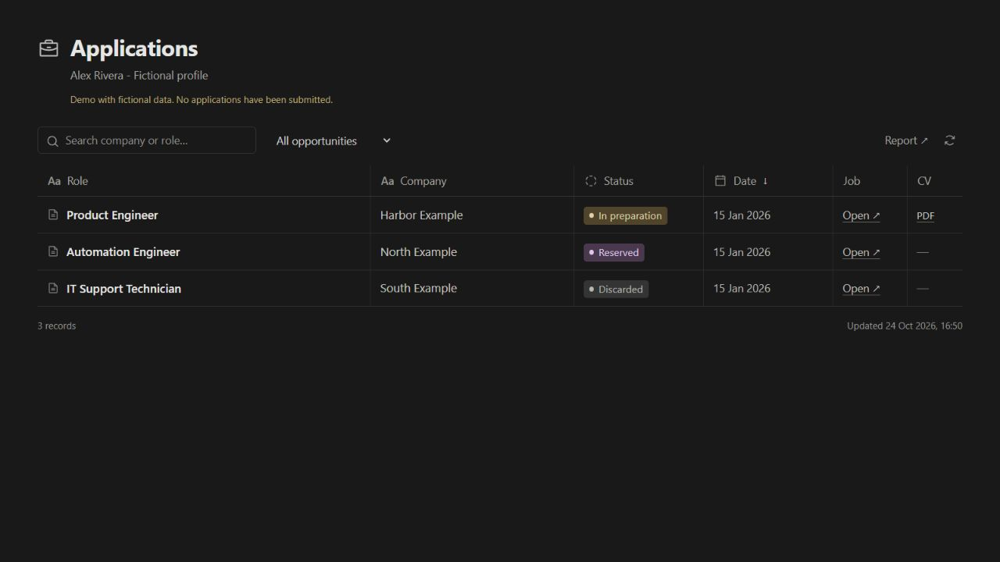

# Job Search Workspace

**Give this repository to your agent and ask it to set up your job search.** Keep job opportunities, tailored CVs, decisions and application outcomes in a simple table.

## Start with one sentence

Share this repository with Codex, Claude Code or another agent with file and terminal access, and say:

> Download this repository and use it as the base for my job search. Set up the app, ask me about my experience and preferences, and start preparing job opportunities and tailored CVs for me to review.

Your agent handles setup using [AGENTS.md](AGENTS.md). You provide your experience, choose your filters and review the results. You do not need to learn the project commands.

The app stores your records and documents. Your agent finds and evaluates jobs using the tools and accounts you authorize. No particular AI provider or job-board credentials are bundled with this repository.



## Try the demo

You can also say: **“Start the demo from this repository so I can see it first.”**

For manual setup, you need **Python 3.11 or later**. The app and demo require no additional packages.

```sh
python run.py demo
```

Open [localhost:8765](http://127.0.0.1:8765). The demo contains three fictional jobs, their assessment and a sample CV. No demo applications have been submitted. Select a row to open its details, or **PDF** to view the CV.

Image previews require Poppler (`pdftoppm`). Without it, you can still open or download the original PDF. Run `python run.py doctor` to check available capabilities.

## Optional manual setup

```sh
python run.py init
python run.py serve
```

Complete `workspace/candidate.json` and `workspace/preferences.json`, or give your agent the prompt in [START_HERE.md](START_HERE.md). The profile separates confirmed facts, scopes of experience and unknowns. Job requirements never become candidate experience automatically.

Each installation has its own private `workspace/`, excluded from Git. The demo uses `workspace-demo/`. All distributed examples are fictional.

## Continue with your agent

Open this folder with an agent that can read files and execute Python, and say:

> Read AGENTS.md and START_HERE.md. Set up this repository as my job-search workspace. Check your tools, collect my experience and preferences without inventing facts, prepare an initial shortlist and tailor a CV for each selected job. Leave applications ready for review; do not submit them without my authorization.

Another agent can continue from the same records. [Compatibility and limitations](docs/AGENTS_AND_TOOLS.md) explains the capabilities required. Browser access, portal sessions and daily scheduling belong to the agent environment you choose.

## What is included

- A searchable table with status filters, dates, job links and PDFs; detail dialogs with reasoning, gaps, tailoring and notes.
- Commands to record opportunities, CVs, decisions, authorizations, observed submissions and reports.
- Duplicate detection by ID, canonical URL, external identifiers and company/title/location.
- Versioned PDFs with SHA-256 hashes. A new draft never replaces a previously submitted document.
- An optional CV generator that links claims to confirmed profile facts.
- Separate states for preparation, reserved jobs, blockers, uncertain submissions and confirmed applications.
- Optional private access through Telegram when hosted behind HTTPS; no extra account for local use.
- Tests for the workflow, document integrity, access controls and source exports.

## Workflow

1. The user confirms their profile, preferences and scope.
2. The agent checks current sources and reads each full job description.
3. `add-job` records the assessment and rejects duplicates.
4. `create-cv` or `attach-cv` creates a specific version; every page is reviewed.
5. `approve` records a real user authorization, and `check-ready` checks the record before the application form.
6. The agent uses the official form. Afterwards, `record-application` stores the observed confirmation, exact PDF and receipt.
7. `report` summarizes the current records.

The commands do not submit forms themselves. A valid source reference cannot prove that a paraphrase is accurate: the agent and user still review the content. See the [full workflow](docs/WORKFLOW.md).

## Generate a CV

```sh
python -m pip install -r requirements-pdf.txt
python run.py --workspace workspace-example init --profile examples/candidate.demo.json --preferences examples/preferences.template.json
python run.py --workspace workspace-example add-job --file examples/job.demo.json
python run.py --workspace workspace-example create-cv --job demo-product-engineer --file examples/cv.demo.json --why "Highlight applications and integrations" --language en
```

This creates a separate example workspace. Do not treat the fictional profile as your own experience. You can also register a PDF from another tool with `attach-cv`; the generator is optional.

## Documentation

- [Start with an agent](START_HERE.md)
- [Workflow and commands](docs/WORKFLOW.md)
- [Data model](docs/DATA_MODEL.md)
- [Codex, Claude and other environments](docs/AGENTS_AND_TOOLS.md)
- [Job sources, salary and freelance work](docs/JOB_SOURCES.md)
- [Privacy and repository exports](docs/PRIVACY.md)
- [Private hosting and Telegram access](docs/DEPLOYMENT.md)
- [Product decisions and next steps](docs/PRODUCT.md)

## Development

```sh
python -m unittest discover -s tests -v
python scripts/audit_export.py
```

Python standard-library backend, HTML/CSS/JavaScript frontend, JSON records and SQLite sessions. No frontend build step. The interface, documentation and examples are in English; individual application documents can use the language requested by the user. Official [Phosphor](https://github.com/phosphor-icons/core) icons are included locally with their license.

This version supports one person per installation. It does not provide a multi-user SaaS, remote browser, central job-search service or autonomous scheduler. Different agents can use it when they have the necessary tools; a complete workflow has not been tested in every agent environment.

[MIT license](LICENSE). Third-party licenses remain alongside their files.
